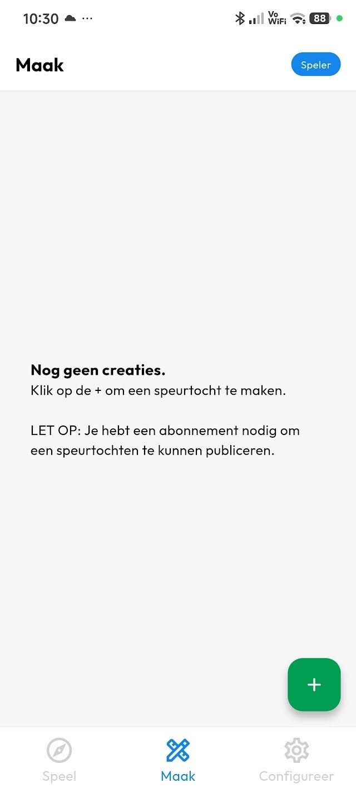
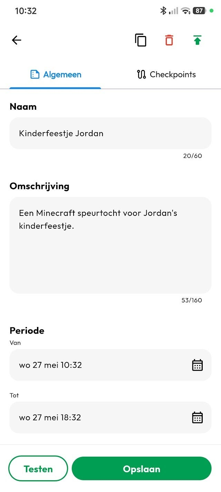
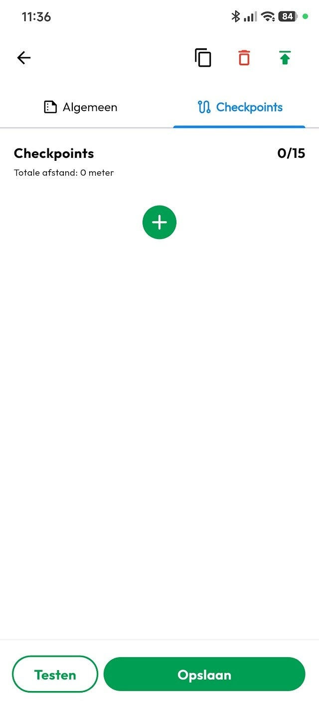
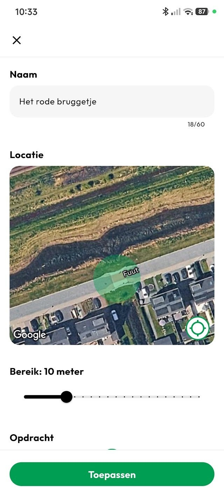
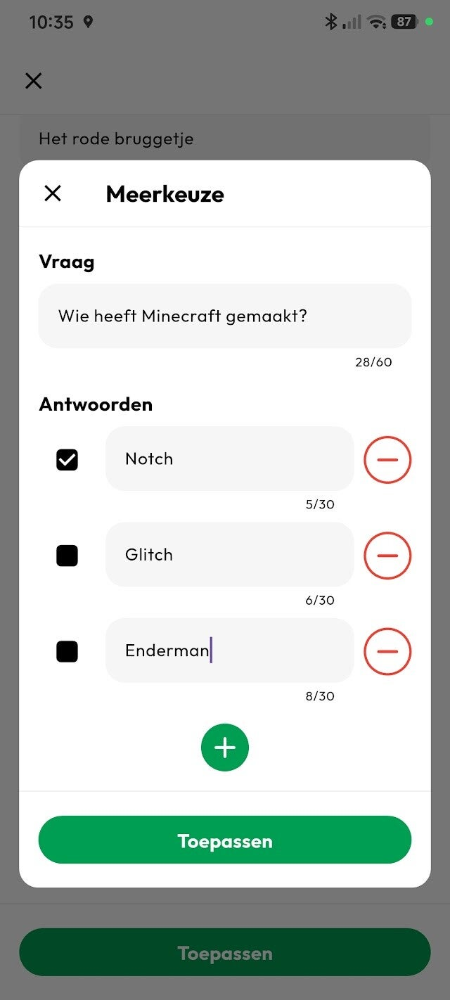
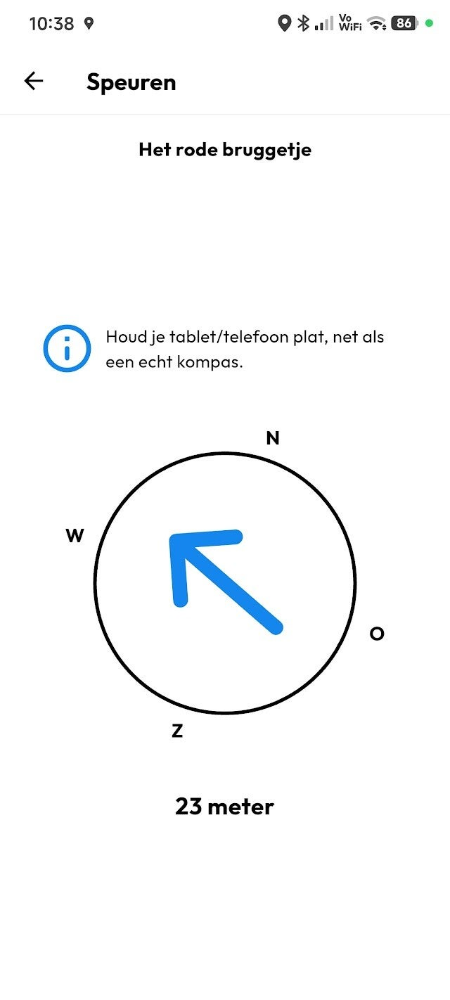
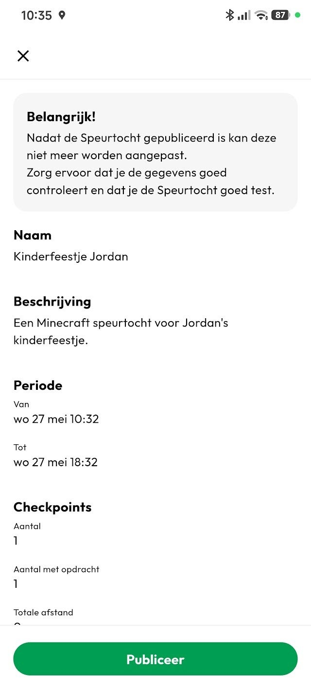
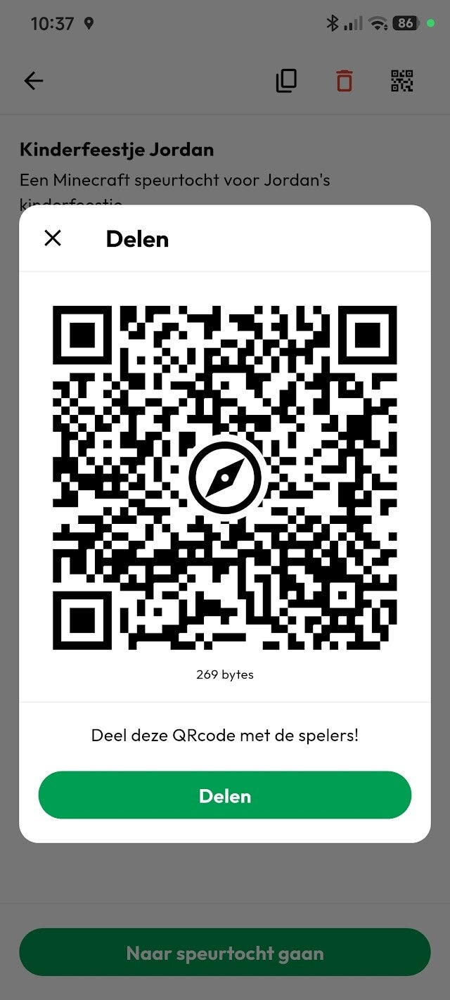

Met de Speurtocht App van Speurtocht Plus, maak je in een handomdraai je eigen GPS-Speurtocht.

## 1. Download de Speurtocht Plus app

Om te beginnen heb je natuurlijk de Speurtocht Plus app nodig.
De app is beschikbaar voor [Apple](https://apps.apple.com/nl/app/speurtocht-plus/id6471435236) en [Android](https://play.google.com/store/apps/details?id=nl.segit.scavenger_hunt&hl=nl), en is gratis te downloaden.

**Let op:** Om een speurtocht te publiceren heb je uiteindelijk een abonnement nodig. De spelers kunnen de speurtochten **GRATIS** spelen!

## 2. Het aanmaken van je Speurtocht

Als je de app hebt geopend klik je onderin op de "Maak"-knop.

Op dit scherm komen alle speurtochten te staan die jij hebt gemaakt.
Klik op de "+" om een nieuwe Speurtocht te maken.

## 3. Omschrijven van je Speurtocht

Na het aanmaken beland je op een scherm waarop je informatie over je Speurtocht kunt invoeren.
Geeft je Speurtocht een duidelijke naam en omschrijving zodat spelers in een oogopslag kunnen zien waar de speurtocht over gaan en voor wie deze bedoeld is.

Je moet ook de periode opgeven waarin de speurtocht gespeeld kan worden. Dit is om te voorkomen dat spelers speurtochten proberen te spelen die niet meer relevant zijn.

Wanneer je deze velden hebt ingevuld kun je beginnen met het toevoegen van *checkpoints*.

## 4. Checkpoints toevoegen aan je Speurtocht

Om checkpoints toe te voegen navigeer je naar de checkpoints-tab, door op de tab te klikken, of door simpelweg naar links te vegen.

Hier zie je het overzicht van alle checkpoints. Door op de "+" te klikken voeg je de eerste checkpoint toe.

Het scherm dat opent vraagt om een naam voor de checkpoint. Deze naam is ook zichtbaar voor de spelers! Je kunt de naam ook als hint gebruiken om de spelers te laten weten waar ze naartoe moeten.

Het scherm toont ook een kaart met een cirkel erop. Dit is het gebied waarin de checkpoint gehaald is. Initieel zal de cirkel op jouw huidige lokatie geplaatst worden. Wij raden ook aan om de speurtocht te maken terwijl je zelf de route loopt. Maar, technisch gezien zou je de speurtocht ook helemaal vanaf de bank kunnen maken, door de kaart te verslepen, en een nieuwe positie aan te klikken op de kaart.
Vervolgens kun je de grote van de cirkel aanpassen.

*De kwaliteit van de GPS verschilt per toestel, maak daarom de cirkel niet te klein om te voorkomen dat spelers gefrustreerd raken dat ze de juiste positie niet kunnen vinden.*

Helemaal onderaan het scherm kun je, optioneel, een meerkeuze vraag toevoegen.
De opdracht is optioneel, zodat je ook checkpoints kunt plaatsen die alleen bedoelt zijn om de spelers een kant op te sturen.
Stel dat de spelers aan de overkant van een vijver moeten zijn om een vraag te beantwoorden, en je wilt dat ze linksom naar de overkant gaan, dan kun je een checkpoint zonder opdracht halverwege aan de linkerkant plaatsen om te voorkomen dat ze rechtsom gaan.

## Zo zoeken de spelers naar checkpoints

De spelers van de speurtocht moeten op basis van een kompas met een pijl de volgende checkpoint zien te vinden. Als ze binnen het bereik zijn van de checkpoint dan spelen ze, indien aanwezig, de vraag vrij. Als de checkpoint geen vraag heeft, dan verschijnt de volgende checkpoint.    [  Meer over Speurtochten spelen  ](/artikelen/3191677_zo-speel-je-een-gps-speurtocht)

## 5. Je Speurtocht Testen

Na het plaatsen van checkpoints kun je voor de zekerheid de speurtocht testen.

Door de speurtocht regelmatig tussendoor te testen voorkom je dat je per ongeluk een speurtocht publiceert met fouten erin.
Wanneer je de test mode start zie je de speurtocht zoals de spelers deze ook zullen zien, met als extra dat je checkpoints kunt overslaan zodat je niet telkens opnieuw hoeft te beginnen. Zo kun je bijvoorbeeld alleen de laatste checkpoint die je hebt toegevoegd even proberen.

## 6. Je Speurtocht Publiceren

Wanneer je alle checkpoints hebt geconfigureerd en getest, en je bent tevreden met het resultaat, dan kun je de speurtocht publiceren.

Het volgende is belangrijk om te weten over gepubliceerde speurtochten:

- Gepubliceerde speurtochten zijn openbaar, maar worden niet getoond in de app. Je moet zelf de speurtocht delen met de spelers middels de QR code.
- Gepubliceerde speurtochten kunnen niet worden gewijzigd. Als je toch nog een fout hebt ontdekt zul je een nieuwe speurtocht moeten maken en publiceren. We hebben wel een handige kopie-functie toegevoegd zodat je niet helemaal opnieuw hoeft te beginnen.

## 7. Je Speurtocht delen met de spelers

Nu dat de speurtocht is gepubliceerd, kun je deze delen met de spelers.

In de rechterbovenhoek zie je een knopje met een QR-code. Als je daar op klikt verschijnt de unieke QR-code die de spelers kunnen scannen.
Je kunt de QR-code ook delen, bijvoorbeeld via mail, whatsapp, of social media.

En dat is het. Zo makkelijk is het om je eigen GPS-speurtocht te maken!

Alvast veel plezier!    [  Download nu!  ](/download)

[ *Zo speel je een GPS-Speurtocht* Volgende » ](/artikelen/3191677_zo-speel-je-een-gps-speurtocht)     [   Delen  ]() [   Deel  ]() [   Share  ]() [   Delen  ]()
