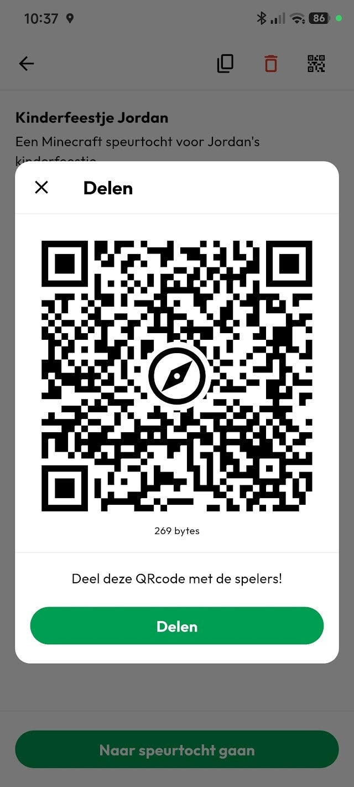
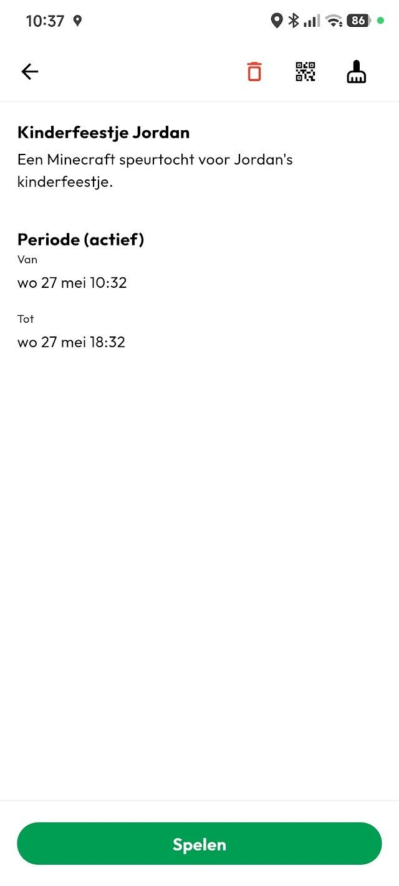
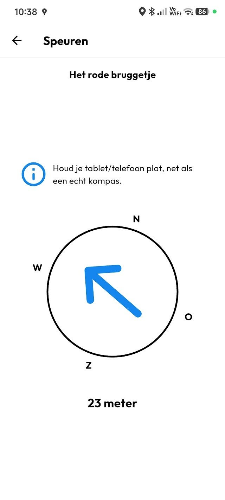
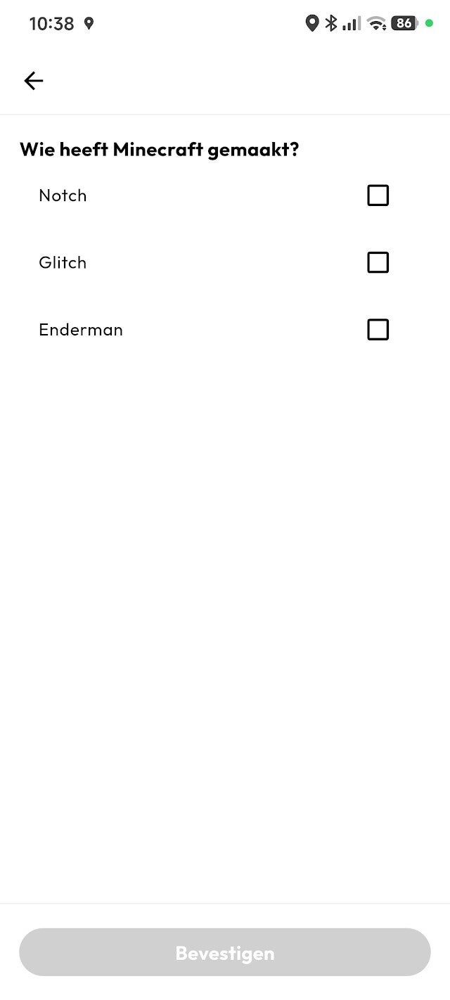
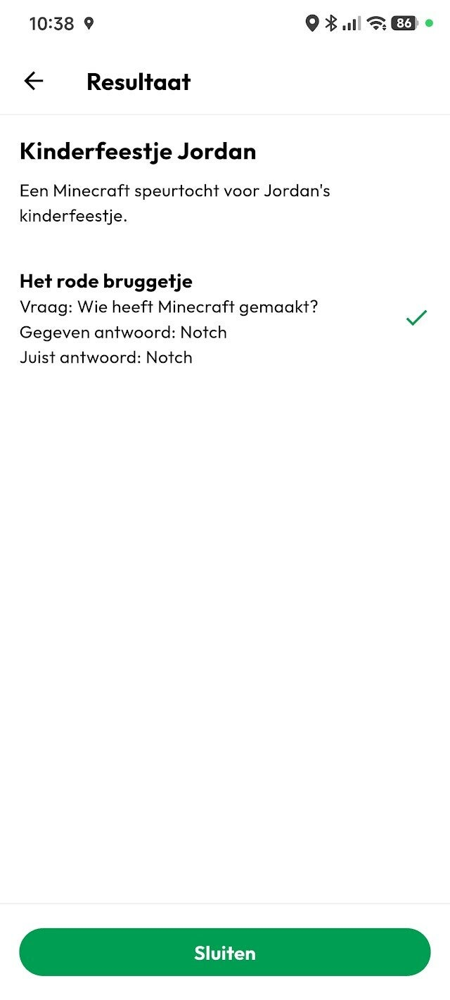

GPS-Speurtochten zijn leuk voor jong en oud.
In dit artikel leg ik uit hoe je een GPS-Speurtocht speelt die gemaakt is met de Speurtocht Plus App.

## 1. Download de Speurtocht Plus app

Om te beginnen heb je natuurlijk de Speurtocht Plus app nodig.
De app is beschikbaar voor [Apple](https://apps.apple.com/nl/app/speurtocht-plus/id6471435236) en [Android](https://play.google.com/store/apps/details?id=nl.segit.scavenger_hunt&hl=nl), en is gratis te downloaden.

Speurtochten kun je **GRATIS** spelen!

## 2. De Speurtocht downloaden

Om een speurtocht te kunnen spelen, moet de maker de speurtocht met jou delen. Zij doen dit door een QR-code met jou te delen.

Als je de app opent kom je direct op het "Speel"-scherm. Bovenin dit scherm kun je een speurtocht toevoegen door de QR-code te scannen.

## 3. De Speurtocht starten

Na het scannen krijg je een overzicht te zien van de speurtocht. Als dit inderdaad de speurtocht is die je wilt spelen, druk je op "Spelen".

## 4. Je eerste checkpoint zoeken

Zodra de speurtocht gestart is krijg je een kompas met een pijl te zien, met daaronder een afstand. De pijl wijst je naar de checkpoint.

Loop in de richting van de pijl.

## 5. Beantwoord de vraag

Sommige checkpoints hebben een opdracht in de vorm van een meerkeuzevraag. Deze zul je moeten beantwoorden om de volgende checkpoint vrij te spelen.

**Let op:** Niet alle checkpoints hebben vragen. Dan zal de volgende checkpoint direct verschijnen. Houd dus goed je aandacht bij het kompas!

## 6. Rond de speurtocht af

Wanneer je alle checkpoints hebt gevonden en vragen hebt beantwoord, krijg je het overzicht te zien van alle checkpoints, de vragen en alle antwoorden die je hebt gegeven. Hier kun je zien hoeveel vragen je goed hebt beantwoord.

Je kunt nu de Speurtocht afsluiten. Het resultaat blijft bewaard, dus je kunt altijd weer terug naar dit scherm, mocht het bijvoorbeeld nodig zijn dat je je resultaat aan de maker van de speurtocht moet laten zien.

Heb je al zin om je eerste GPS-Speurtocht te spelen?    [  Download de app  ](/download)

[ « Vorige *Zo maak je eenvoudig je eigen GPS-Speurtocht* ](/artikelen/3191676_zo-maak-je-eenvoudig-je-eigen-gps-speurtocht) [ *Een betaalbaar kinderfeestje organiseren* Volgende » ](/artikelen/3210766_een-betaalbaar-kinderfeestje-organiseren)     [   Delen  ]() [   Deel  ]() [   Share  ]() [   Delen  ]()
